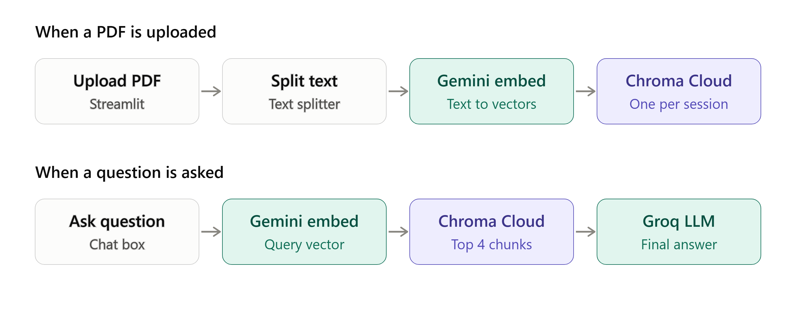
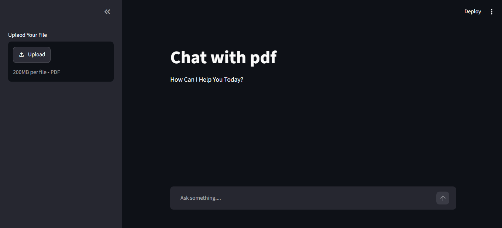
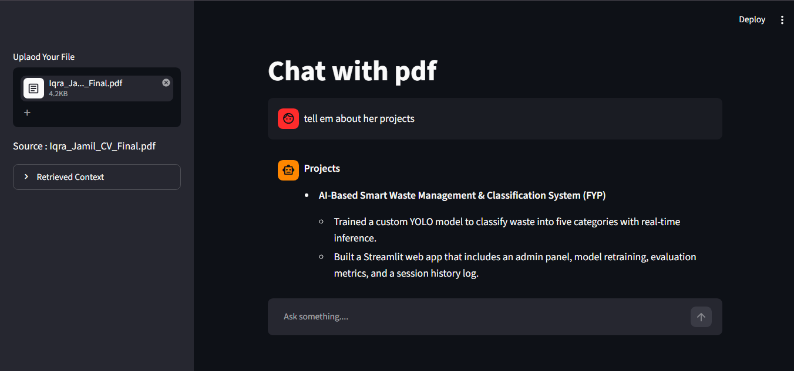

- if user_query is not None:
 handle only NOne and it nver handle "",[],0,False,{}
- if user_query:
handle not only NOne but also "",[],0,False,{}

- few Streamlit widgets themselves preserve 
like file_uploader preserve documnt
### we will see later
### chaining
### where session state variable store data
- st.session_state stores data in Streamlit's server-side memory for that user's active session.
## problem i faced :
- The problem I faced was that Streamlit reruns the script every time the user sends a query. I thought that because client and collection were recreated on every rerun, they would become empty since the PDF processing code does not run again.

- However, the newly created Chroma client was still able to access the previously stored collection data. This is because chromadb.Client() uses in-memory storage, and the data remains in the running Python process. Recreating the client does not necessarily create a completely new empty database. The new client can access the existing in-memory(app's RAM) Chroma data while the app process is still running.
# reason to keep one client instaed of recraeting client on evry rerun
- if your Streamlit app is running on your PC, the Chroma data is stored temporarily in your PC's RAM.
- even new client is pointing to the old db data wihc is in-memry db right?? and yu are saying a differnt version of chroma may craete new store for a new client right??? and pointing of new client on 2nd run to the new database will have no data at all bcz  so may be infuture i use any otehr chroma version and that version may not behva e as my curent chroma version 
- The reason to keep one client is mainly simplicity and avoiding unnecessary client creation
# what is @st.cache_resource
- @st.cache_resource tells Streamlit to run the function once, save what it returns, and hand back that same saved object on every rerun instead of running the function again.
- @st.cache_resource is a Streamlit decorator that tells Streamlit to create a resource once and reuse the same object across reruns.
- For example, our Chroma client is created once, then the same client is reused instead of creating a new one on every rerun.

### what is User's streamlit session 
means the connection between a bowser tab and the UI of the app we are displaying on that browser
### how we can prevent client from recraeting on evry run
- by creating a function using @st.cache_resource (appropriate choice)
- or by using sessiion state variable 

# where the data of both stored
### st.session_state
- data stored for a specific streamlit user's session
- it store the data in streamlit's server memory(streamlit's RAM)

### @st.cache_resource 
- we can share/reuse it across different sessions
- it store data on application level cahche
# when the data will be cleared from both 
### st.session_state
- Cleared when that user's session ends or is reset.
### @st.cache_resource 
- Cleared when the cache is cleared, the app process restarts, or the cached function/code changes in a way that invalidates the cache.
# whats themain differnce beween both
### st.session_state
- session-specific data.
### @st.cache_resource 
- reusable application-level resources.
# for what they mainly designed for
### st.session_state
- Chat history
- User selections
- Uploaded-file state
- UI state
### @st.cache_resource 
- is shared across users and sessions by default.(so we cant use it to persist chat history)
- Database clients
- API clients
- ML models
- Chroma clients
- Other expensive resources you want to create once and reuse.

### chromadb.Client() and chromadb.PersistentClient
chromadb.Client() → keeps Chroma data in memory and the data can disappear when the app process restarts.
chromadb.PersistentClient(path="./your_directory") → persistent local storage

## why then we also didnt use @st.cache_resource
- The problem is @st.cache_resource makes the same chromadb.Client() shared across users.

# embed_and_store

- return True at the end of try means "embedding worked", and return False in except means "embedding failed".
- store True and false in a variable
 
- st.session_state['processes_file'] = uploaded_file.name runs every time, even when embedding isnide embed_and_store failed.st.session_state
- neechy aien gy processes_file != uploaded_file.name
yeh line file name ko update kr dy ge yani yeh line btay ge k file process ho chuki h(embeding ho chuki h)
- so now when user will send a query script rerun ho ge and chat start ho jay ge embeding to hoes nai but empty colection LLM k pass jaa rai h 
- so now LLM will give no info on evry query
- to handle this we need to track if emebding fail hoe h ya sucessfull
- so now we will upadte file name only when the function is returning tRue else that line should be skipped 
- ab jab name he upadte nai hoa ho ga or user query bhjy ga embeding wala function dubara run ho ga bcz processes_file != uploaded_file.name yeh condition ab true h 

# Architecture Diagram

# App  Screenshots

# Interview questions
## 1. What is RAG, and why use it instead of sending the whole PDF to the LLM?
- RAG stand for retiveal augmented generation
- its a technique we use jab user source documnt say user k quetion say relevent information ko retrive krny k liy relevent data vector embeddings ko use kr k similarity srch kr k fetch kia jaata h aor LLM ko behja jata h 
- LLM ke context limit km hoti hai aor pura pdf ziada bara ho skta h aor is k ilawa us my irrelevnt information bhi LLM k paas jaa skti h jis sy LLM confuse ho skta h aor better resposne nai kar skta 
- cost bhi barhti h 
## 2. Why do you split the PDF into chunks, and what does `chunk_overlap` do?
- pdf ko chunks main split is liy kia taaky har piece of txt ke apni focused vector list ban sky aor retrival main srf relevent chunks ko retrive kia jaasky 
or we could say :
PDF ko chunks mein split karne ka main reason ye hai ke har chhote text piece ka separate embedding ban sake. Phir jab user koi query karta hai, to vector similarity ke through poore document ki bajaye sirf query se relevant chunks retrieve kiye ja sakte hain. Isse retrieval zyada focused aur efficient hota hai
- chunk_overlap means if i set its value to 100 is ka matlab h k pichly chunk k 100 characters nxt chunk k start main repeat hn taa k contxt lose na ho k pichly chunk main kia baat horhi thi

## 3. Why do you use different task types for documents and queries?
task type is liy set kia taaky model ko pta ho k us ko kis ke vector embedding krni h source documnt ke ya user k question k ,user ka quetion chota hota h aor documnt bara hota h soo model model dono ko alga treeeky sy embed krta h 
## 4. Which distance metric does Chroma use in your app, and is it the right one?

- meri app main chroma ko default metric L2 distance use horha h ye do vecttors k darmian main distance ko measure karta h distance jitna kam ho vectrs utny apas main similar hoty hain 
- we can use L2, cosine, ya inner product to measure similarity srch

## 5. What does the similarity search return, and what does `n_results=4` control?
- similarity search query k vectrs ko stored vectrs k sath comapre krti h aor jo sab sy ziada relevent vectrs hoty hain un chunks ko retrn krti h 
- n_results=4 top 4 relevent chunks retrn krti h 
## 6. Why did you choose `chunk_size=10000`, and what are the trade-offs?
- main ny 10000 is liy set ke kion k testing main mujy is value par best anser mila
- trade off ka matlab h aik cheez ka faida leny par dusri cheez ka nuksaan hota h yaani dono cheezain perfct nai mil skti 
- chota chunk size rakhny sy resposne main precison milti h lkn information cut ho skti h 
- bara chunk size rkny sy unecassry information mil skti h
- so aisi value rakhni chai jis sy better information mily
## 7. Why is your temperature 1.0, and would you change it?
Temperature response ki randomness control karti hai. Maine 1.0 rakha tha, lekin document Q&A ke liye kam value, jaise 0.2, behtar hai, kyunke mujhe steady aur document-based answers chahiye, creative nahi
## 8. How does your system prompt prevent hallucination, and what are its limits?
- sytem prompt define how a model should behave 
- system prompt prevent hallucination by the instrction i gave it that it should respond on the basis of provided info only , and should not respond when irelevent quetion asked 
- the limit of systm prompt is its not guarantee that model will follow the isntrctions especially when temprature is high,model will have to respond creative
- agr retrival ghlt ya cut chunks dy to model uni par jawab dy ga aor resposnes cut ho skty hain ya ghlt ho skty hain

## 9. Why do you use `st.session_state`?
we use st.session_state to survive streamlit's reruns kion k reruns par normal variables main stored values persist nai reh sktin,rerun har aik user interaction par hota h 

## 10. How do you keep each user's data separate and handle a new PDF?
- i kept each user's data by creating a seprate collection for each session a single user can have differnt sessions 
- us case main user ka collection name dono sessions main differnt ho skta h
- user jab new pdf upload krta h to purani collection dlt ho jati h usi same session main new collection same name k sath banti h aor new documnt us mian jaata h 

11. Explain the complete flow of your Chat with PDF application.

12. Why do you split the PDF into chunks instead of embedding the complete PDF?
PDF ko chunks mein split karne ka main reason ye hai ke har chhote text piece ka separate embedding ban sake. Phir jab user koi query karta hai, to vector similarity ke through poore document ki bajaye sirf query se relevant chunks retrieve kiye ja sakte hain. Isse retrieval zyada focused aur efficient hota hai

13. What is the difference between document embeddings and query embeddings?
- documnt embeddings ka matlab h documnt k txt ko vectrs main convert krna 
- query embedings ka matlab h query txt ko vectrs main convert krna 
- dono ko same embedding space main convert kia jaata h (matlab dono ke embedings k liy same model use kia jaata h )
- taaky baad main similarity srch kr k relevnt data retrive kia jaa sky 

14. Why are you using Chroma in your project?
Chroma ek vector database hai. Main is project mein document chunks ke embeddings, unka original text aur metadata store karne ke liye Chroma use kar rahi hoon. Jab user query karta hai, Chroma query embedding ke basis par similarity search perform karke relevant chunks retrieve karta hai. Maine Chroma isliye choose kiya kyunki ye simple aur beginner friendly tha, aur is project mein RAG pipeline ko samajhne ke liye suitable tha.

15. Why do you generate a UUID for every chunk?
UUID har chunk ko uniquely identify karne ke liye generate karti hoon, taake Chroma mein har chunk ka unique ID ho.

16. What does n_results=4 mean in your retrieval function?
n_results=4 ka matlab hai ke vector database query ke liye top 4 most relevant chunks retrieve karega

17. Why do you use InMemoryChatMessageHistory?
- InMemoryChatMessageHistory → messages ko memory mein rakhti hai.

- st.session_state → us object ko reruns ke across preserve karta hai.

18. Why are you adding SystemMessage separately instead of storing it in msg_history?
Main SystemMessage ko msg_history mein add nahi karti because retrieved context har query ke saath change hota hai. Agar main usay history mein add karti, to previous queries ke retrieved chunks bhi next request ke saath LLM ko send hote rehte. Isse unnecessary aur potentially irrelevant context accumulate hota. Isliye main current query ke retrieved chunks ko separately SystemMessage mein pass karti hoon.
19. What is the purpose of st.session_state in your application?
Streamlit mein user interaction ke baad script rerun hoti hai. Har rerun mein normal variables dobara initialize hote hain, isliye unka previous data maintain nahi rehta. st.session_state ka purpose data ko reruns ke across maintain karna hai. Mere project mein main isse chat history, uploaded file ka name, retrieved chunks aur kuch other state variables maintain karne ke liye use karti hoon.

20. Why did you use @st.cache_resource for your Chroma client, and what is the important issue with it?
- @st.cache_resource Streamlit ka decorator hai jo expensive resources ko cache karta hai, taake har rerun par resource dobara create na ho. Maine ise Chroma client ke liye use kiya hai. Important issue ye hai ke cached resource users aur sessions ke across shared ho sakta hai. Isliye mujhe ensure karna hota hai ke different users ki collections properly isolated hon. Mere case mein main UUID based collection name use kar rahi hoon
- Client ek baar create ho sakta hai, phir cached same client multiple users aur sessions ke across reuse ho sakta hai.